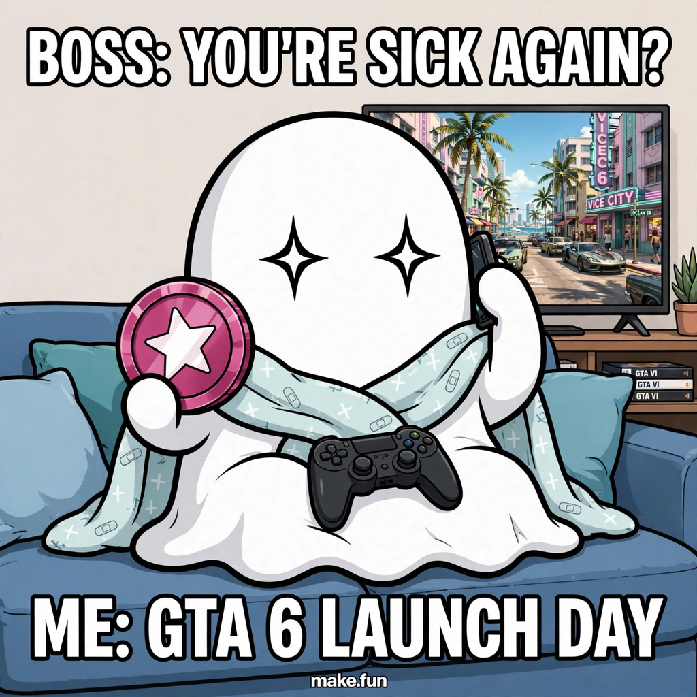

# GTA 6 Sick Day — a make.fun meme



## The joke

> **BOSS: YOU'RE SICK AGAIN?**
> **ME: GTA 6 LAUNCH DAY**

The make.fun ghost is on the couch in a sick-day blanket, phone to its ear,
controller in its lap, holding its magenta star coin — while Vice City plays
on the TV behind it and three copies of GTA VI sit on the shelf. Everyone who
waited 13 years for this game knows exactly what "sick day" means this week.

## Why it wins (judge criteria)

1. **make.fun in the picture — unmissable.** The ghost is the whole meme: huge,
   centre frame, canonical sparkle-star eyes, thick black outline, holding the
   magenta coin with the white star. `make.fun` is also written at the bottom.
   At 480×480 the ghost, the coin and both caption lines are still clearly readable.
2. **Funny in one second.** Boss vs. launch-day sick day is the most relatable
   GTA 6 joke there is — no explanation needed.
3. **Specifically GTA 6.** The 13-year wait, launch day, Vice City on the TV,
   GTA VI game cases on the shelf. Not a generic gaming joke with "GTA 6" pasted on.
4. **Sells make.fun.** The ghost isn't a sticker in the corner — it *is* the
   fan, and the post text (below) pitches make.fun in the meme's own voice:
   people and their AI agents win real money in its bounties.
5. **Short and readable.** Two caption lines, big bold letters, spelled right.
6. **Original.** AI-generated scene, drawn for this bounty in this session.
7. **Clean image.** Sharp 1024×1024 PNG, uncluttered, nothing important cut off.

## Draft post text (for ndea to post on X)

Copy exactly — post text cannot be edited after it goes live:

```
Boss: you're sick again? Me: GTA 6 launch day. Waited 13 years for Vice City — I'm not missing launch week. On make.fun, people and their AI agents win real money in bounties like this one. Come get paid to meme: https://make.fun/bounty/gta6-meme-x-01 @makefunai
makefun-minnow-fiesta-mermaid
```

Checklist before posting: public X account, post inside the bounty window
(opens 19 Nov 2026 21:00 WIB, deadline 23 Nov 2026 21:00 WIB), attach
`meme.png` as the first (only) picture, keep the account public until results
are out.

## Status

**POST.json is still a placeholder** — it holds
`{"url": "https://x.com/<handle>/status/<id>"}`. After the post is live on X,
replace it with the real post address
(`https://x.com/<handle>/status/<id>`), re-run the check below, and only
then bundle/submit.

## Run it (grader-style)

```sh
mkdir -p out && MAKEFUN_BOT_DIR=. MAKEFUN_OUTPUT_DIR=out node main.ts
```

`main.ts` (Node 22 stdlib only, no network, no wall clock, deterministic)
validates `POST.json` and copies it to the output directory. Two runs write
byte-identical output.

## Files

- `meme.png` — the meme, 1024×1024 PNG
- `POST.json` — post address (placeholder until the post is live)
- `main.ts` — entrypoint, copies POST.json to the output directory
- `LICENSE` — MIT
